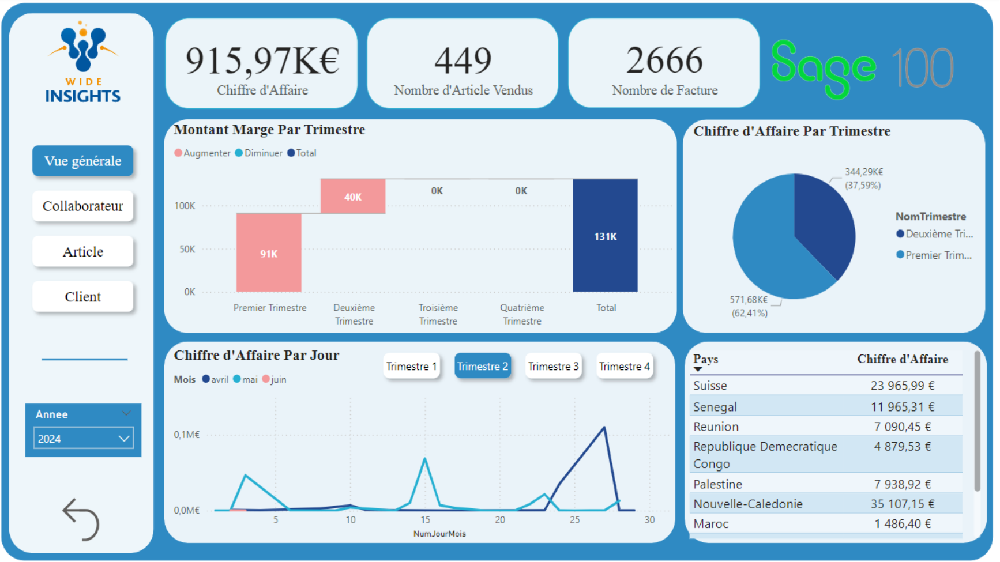
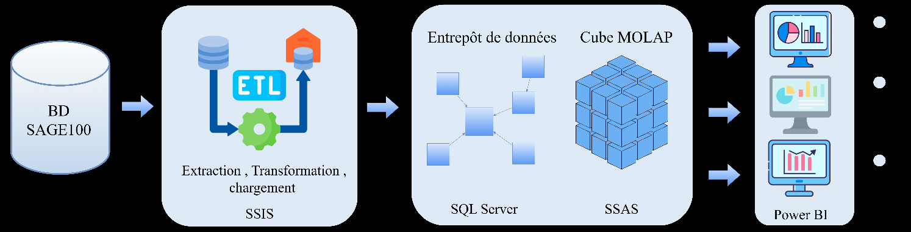
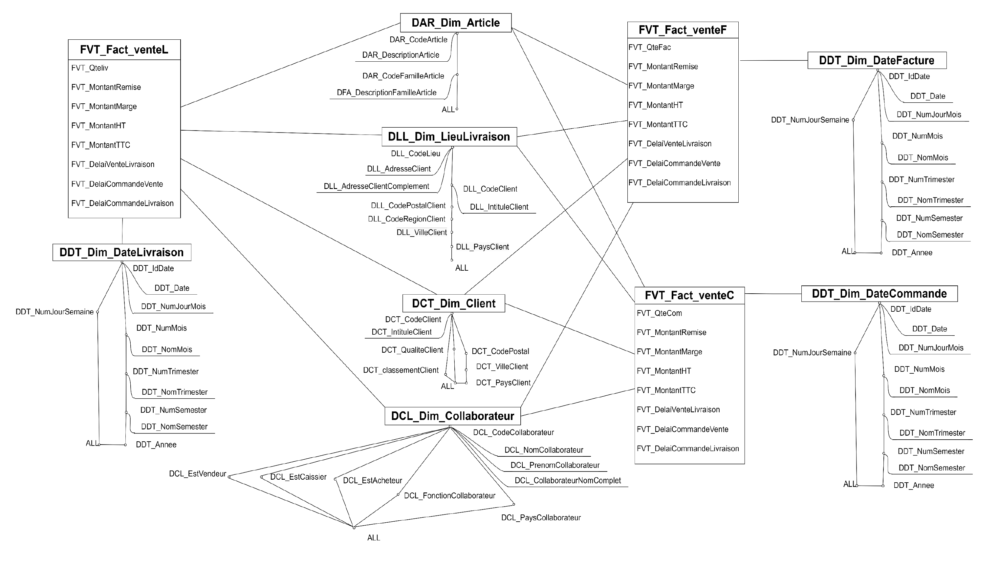
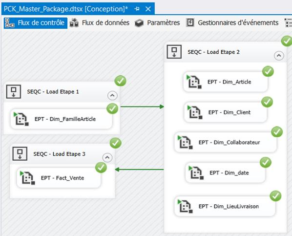
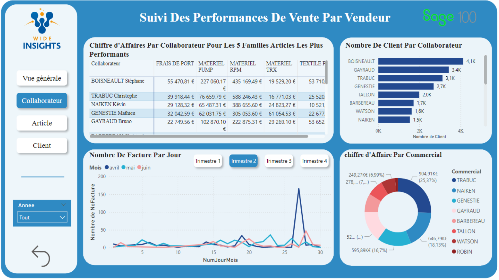
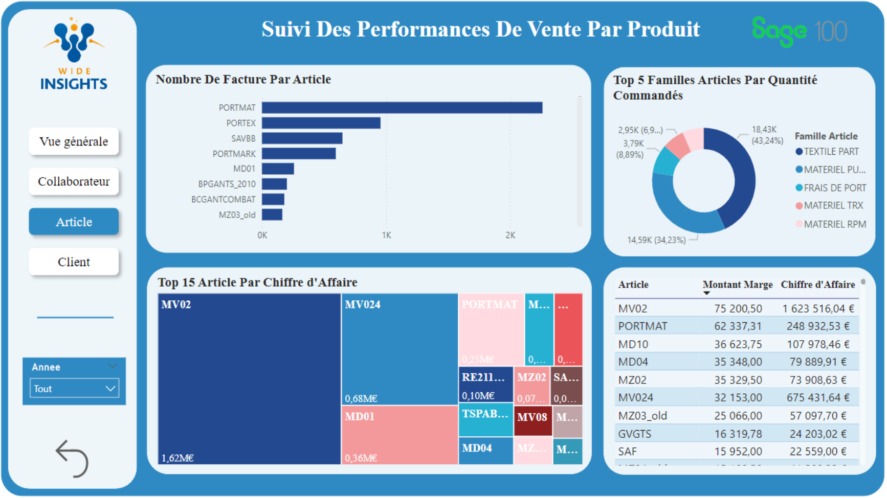
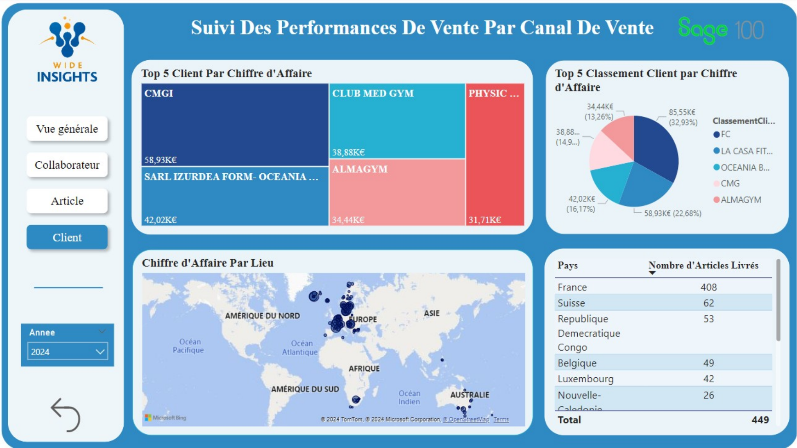

# 📊 Sage 100 Sales BI — Data Mart, SSIS ETL, SSAS Cube & Power BI

End-to-end **Business Intelligence solution** built on the **Sage 100 ERP** to analyse sales performance:
a sales **data mart** in SQL Server, an automated **ETL** pipeline with **SSIS**, a **MOLAP cube** with **SSAS**,
and interactive **Power BI dashboards** for decision-makers.


> Bachelor's final-year project (*Projet de Fin d'Études — Licence en Big Data et Analyse de Données*), 2023/2024,
> carried out at **Wide Insights**, managed with **Scrum** (4 sprints, tracked in Jira).



---

## 🎯 Problem & solution

Sage 100 manages sales, purchases, stock and accounting, but offers **limited reporting**, **limited data analysis**
and **little customisation** of reports. This project adds a decision-support layer on top of it:

| Need | Solution |
|---|---|
| A clean, analysis-ready data source | Sales **data mart** (constellation schema) in SQL Server |
| Automated, scheduled data integration | **SSIS** packages orchestrated by a master package, scheduled with SQL Server Agent |
| Fast multidimensional analysis | **SSAS MOLAP cube** with date, product, customer, sales-rep and location dimensions |
| Interactive reporting for managers | **Power BI** dashboards (overview, sales rep, product, customer/channel views) |

## 🏗️ Architecture



**Sage 100 database → SSIS (Extract, Transform, Load) → SQL Server data mart → SSAS MOLAP cube → Power BI**

---

## 1️⃣ Data mart modelling (Sprint 1)

Bottom-up approach (Kimball): reverse-engineering of the Sage 100 schema, then identification of facts, dimensions and hierarchies.

- **Fact tables:** sales by order, invoice and delivery
- **Measures:** quantities ordered / invoiced / delivered, discount, margin, amounts (excl. & incl. tax), sales-to-delivery and order-to-delivery lead times
- **Dimensions:** Article (→ Article family, snowflake), Client, Collaborateur (sales rep), Lieu de livraison (delivery location), Date (role-playing: order, invoice, delivery)



The SQL script that creates the data mart is in [`sql/DMS_Sage100.sql`](sql/DMS_Sage100.sql). It includes an **audit table** that logs every ETL run.

## 2️⃣ ETL with SSIS (Sprint 2)



- **`PCK_Master_Package`** orchestrates the whole load in 3 stages: article family → other dimensions → fact table.
- **Dimensions:** **Slowly Changing Dimensions** with history (validity dates `ValideDu` / `ValideAu`), and a default "unknown" member for missing keys.
- **Date dimension:** generated by SQL script.
- **Fact table:** a **full initial load** the first time, then **incremental loads** of the last 90 days.
- **Audit:** row counts (source / inserted / updated) logged for every package execution.
- **Scheduling:** SQL Server Agent job for the automatic, scheduled refresh of the ETL and the cube.

## 3️⃣ OLAP cube with SSAS (Sprint 3)

- **MOLAP** cube built on the data mart (data source view `DSV_SAGE100`), with dimensions, hierarchies, measures and measure groups.
- Deployed to SQL Server Analysis Services and **processed automatically** after each ETL run.

🎬 **Demo video** (ETL execution, cube browsing, job scheduling): [`docs/demo-etl-cube.mp4`](docs/demo-etl-cube.mp4)

## 4️⃣ Power BI dashboards (Sprint 4)

Designed for three types of users: **manager** (strategic BI), **sales director** (tactical BI) and **sales rep** (operational BI).

| Sales rep view | Product view | Customer & channel view |
|---|---|---|
|  |  |  |

KPIs include revenue, number of items sold, number of invoices, margin by quarter, revenue by day / country / sales rep / product family,
top customers and top products.

---

## 📁 Repository structure

```
├── SAGE100_BI.sln          Visual Studio solution (SSIS + SSAS projects)
├── SSIS/                   ETL packages (.dtsx), connection managers, project parameters
├── SSAS/                   Cube, dimensions, data source and data source view
├── sql/                    Data mart creation script
├── powerbi/                Power BI report (.pbix)
└── docs/                   Report (French), demo video, screenshots
```

## 🚀 How to open the project

**Requirements:**
- SQL Server 2019 with Integration Services and Analysis Services (Multidimensional mode)
- Visual Studio 2019/2022 with the *SQL Server Integration Services Projects* and *Analysis Services Projects* extensions
- Power BI Desktop

**Steps:**
1. Run `sql/DMS_Sage100.sql` in SSMS to create the data mart.
2. Open `SAGE100_BI.sln` in Visual Studio.
3. Update the connection managers (`SSIS/*.conmgr`, `SSAS/DS_SAGE100.ds`) with your own SQL Server instance name. They use Windows authentication, so no password is stored.
4. Run `PCK_Master_Package.dtsx`, then deploy and process the SSAS cube.
5. Open the `.pbix` file in Power BI Desktop and refresh the data source.

> The source Sage 100 database is not included in this repository.

## 📄 Documentation

The full project report (in French, 100 pages) is available here: [`docs/Rapport_PFE_Licence_FR.pdf`](docs/Rapport_PFE_Licence_FR.pdf).

## 👩‍💻 Authors

- **Chaima Maatar** — [GitHub](https://github.com/MaatarChaima)
- **Salha Hentati**

Supervised by Mme. Faiza Ghozzi and Mr. Ghassen Khabou.
